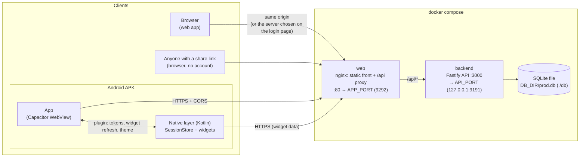
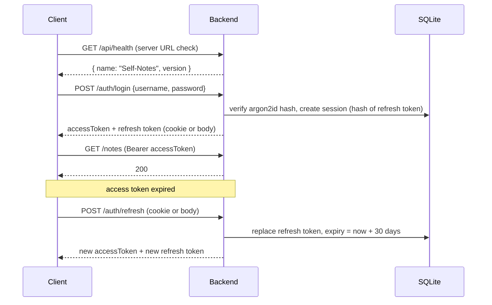
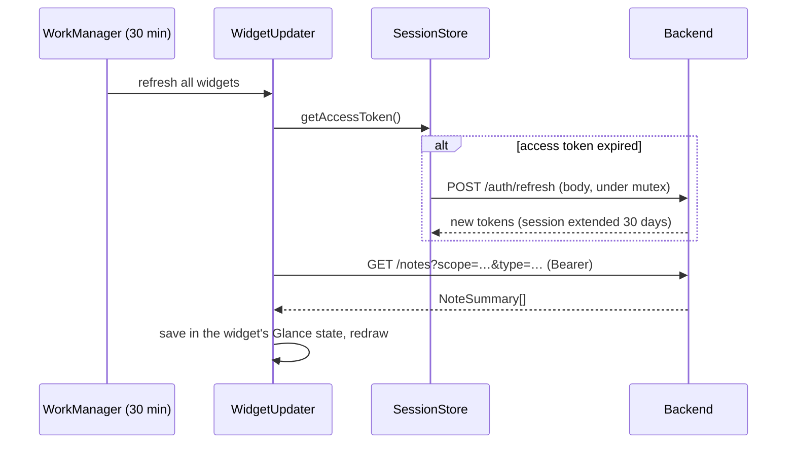

# Architecture

## 1. Overview



- **web** (nginx, host port 9292 by default) is what clients use. It serves the built React app and proxies `/api/*` to the backend. The backend is also published on 9191, bound to the host's loopback by default, for a reverse proxy or tools on the host. In the browser, the front and the API share one origin: there is no CORS and the refresh cookie stays same-site.
- **backend** is the REST API. It runs database migrations at startup (`prisma migrate deploy`).
- The **database** is a SQLite file opened by the backend: `prod.db` in the host folder `DB_DIR` (default `./db`), mounted on `/app/db`. There is no database server, and a backup is a copy of that file (see [deployment.md](deployment.md#backups)).
- The **Android app** is the same React build packaged by Capacitor. Its WebView origin is `https://localhost`, so it calls the server across origins. The server allows this through `CORS_ORIGINS`.
- The **Android native layer** (Kotlin, in the Capacitor project) owns the session on Android and runs the **home-screen widgets**. Widgets call the API directly, without the WebView (see §6).
- The **server URL is a client setting**, chosen on the login page (AUTH-6). Every API call goes to `<serverUrl>/api/...`.

## 2. Tech choices

| Decision | Choice | Why |
|----------|--------|-----|
| Mobile approach | **Capacitor** (web app packaged as an APK) | A web front is needed anyway, because share links must open in any browser. One codebase covers web and Android, and the APK is built in CI with Gradle. |
| Front framework | **React + TypeScript + Vite** | Mature tooling and a good Markdown ecosystem (`react-markdown`, `remark-gfm`). |
| Server state on the front | **TanStack Query** | Caching, retries and optimistic updates (checkbox toggles). |
| API framework | **Fastify + TypeScript** | Fast, schema-first, and generates OpenAPI from zod schemas. |
| ORM / migrations | **Prisma** | Typed queries and versioned SQL migrations. |
| Database | **SQLite** (WAL mode) | One file next to the stack, nothing else to run or tune, easy backups. Enough for a self-hosted server: one writer at a time, readers never wait. Case- and accent-insensitive search and sorting use keys computed by the API ([data-model.md](data-model.md#folded-keys)). |
| Note storage format | **Markdown for both types** | One portable format. A list is a GFM task list, so it renders correctly everywhere, even outside the app. |
| Concurrent edits | **Optimistic concurrency** (`version` column, HTTP 409) | Simple and safe for v1. Real-time collaboration is on the roadmap. |
| API contract | **OpenAPI** generated by the backend, TypeScript types generated for the front | The front and back cannot drift apart silently. |
| Android widgets | **Jetpack Glance + WorkManager** (Kotlin), inside the Capacitor Android project | A widget cannot be a WebView. Glance is Android's current widget toolkit, and WorkManager runs the periodic refresh with little battery cost. |

## 3. Authentication

- **Access token**: a JWT signed with `JWT_SECRET`, valid for `ACCESS_TOKEN_TTL` (default 15 min). It is sent as `Authorization: Bearer <token>` and kept **in memory** on the client.
- **Refresh token**: 256 random bits. Only its SHA-256 hash is stored, in `sessions`. It is **replaced on every refresh**.
- **Sliding expiry (no daily login).** Every refresh issues a new token valid for `REFRESH_TOKEN_TTL` (default **30 days**) from that moment. There is no absolute maximum, so a session ends only after 30 days without use, on logout, or on a password change. On Android, the widgets' 30-minute refresh counts as use, so the phone stays signed in (AUTH-4, WIDGET-9).
- **Theft detection, with a grace period for bad networks.** If a refresh token that was already replaced is used again, the server normally revokes the whole session family. There is one exception: the token was replaced **less than 2 minutes ago** and its replacement has **never been used**. That is the usual sign of a response lost on a mobile network, not of theft. In that case the server revokes the unused replacement and issues a new token, so the user is not logged out.
- **How the refresh token is carried**, chosen by the client with the `X-Token-Transport` header:
  - **cookie** (default, web on the same origin): an `httpOnly`, `SameSite=Strict` cookie (`Secure` over HTTPS), scoped to `/api/v1/auth`;
  - **body** (`X-Token-Transport: body`): returned and sent in the JSON body. Android always uses this, and stores the token in the native `SessionStore` (§6). The web app uses it only when the user picked a server on another origin, because cookies are not sent across sites. The refresh token then lives in `localStorage`, which is weaker against XSS. That is accepted because raw HTML is never rendered (NFR-5).
- **Server URL:** the client stores it (localStorage on web, `SessionStore` on Android). The login page validates it with `GET /api/health`, which must answer `{ "name": "Self-Notes", ... }`. A server on another origin must list the client's origin in its `CORS_ORIGINS`.



**Share links** are not part of user authentication. Requests to `/api/v1/shared/{token}` find the link by token and get the link's role. They never get access to anything else.

### Locked notes (NOTE-17)

A locked note is encrypted **in the client** (WebCrypto): PBKDF2-SHA256 with 600 000 iterations derives an AES-256-GCM key from the note's password and a random salt. Only the title, the type and the envelope reach the server. The key stays in memory while the note is open (`useNoteLock` in `features/notes/locking.tsx`); `lockingSaver` encrypts every save, decrypts conflict details, and turns checkbox toggles and type conversions into ordinary content saves, because the server cannot read the content. Everyone with access (members, share links) unlocks with the same password.

Limits, by design: a forgotten password loses the content; whoever holds the envelope (members, share-link holders, the server admin) can try passwords offline, which PBKDF2 only slows down, so the app asks for at least 8 characters and recommends long ones; the title stays readable.

## 4. Authorization

All access checks happen on the server, in one place (`notes/access.ts`), which works out the caller's **role** for a note:

1. a user's row in `note_members` → `owner` | `editor` | `viewer`
2. otherwise, for `/shared/{token}` routes: a valid share link (not revoked, not expired) → `editor` | `viewer`
3. otherwise → **404** (the API never confirms that a note exists to someone without access)

Each route declares the minimum role it needs. The permission matrix in [specification.md §5.3](specification.md#53-permission-matrix) is tested exhaustively.

## 5. Markdown and lists

- **Rendering:** `react-markdown` + `remark-gfm`, with **no** raw HTML plugin, so raw HTML is never rendered. A custom link renderer adds `rel="noopener noreferrer"` and drops `javascript:` URLs.
- **Table of contents (NOTE-18):** `remarkToc` (`frontend/src/markdown/toc.ts`) gives top-level headings GitLab-style ids, prefixed with `user-content-` so that a note never takes the id of an app element, and replaces a `[[_TOC_]]` / `[TOC]` paragraph with a nested list of `#anchor` links. The link renderer scrolls to `user-content-<anchor>` instead of navigating.
- **Mermaid (NOTE-19):** the `pre` renderer hands ```` ```mermaid ```` blocks to `MermaidDiagram` (`Mermaid.tsx`). `mermaid` is imported on demand (its own chunk), renders one diagram at a time with `securityLevel: 'strict'`, `htmlLabels: false` and theme-derived colors, and its SVG goes through DOMPurify before `dangerouslySetInnerHTML`: the one exception to "no raw HTML" (NFR-5). The CSP needs nothing new (`style-src 'unsafe-inline'` was already there for inline styles). Server previews skip Mermaid sources and TOC markers.
- **Links, addresses and phone numbers (NOTE-15):** `remark-gfm` turns bare web and email addresses into links. `remarkAddresses` (`frontend/src/markdown/addresses.ts`) turns postal addresses (French and English patterns, outside code and existing links) into `geo:0,0?q=<address>` links. `remarkPhones` (`phones.ts`) turns French national and `+` international numbers into `tel:` links. The URL transform allows `geo:` and `tel:` in addition to react-markdown's safe list. A `geo:` link names no map provider. On Android, `SelfNotesNative.shouldOverrideLoad` opens it with `Intent.createChooser`, so the user always picks among the installed maps apps. In a phone browser the system handles it; desktop browsers usually have no handler for `geo:`.
- **List notes:** the front parses the content into items `{checked, text}` for the checklist UI, then writes it back as `- [ ] text` / `- [x] text`. Lines that are not items are kept as they are. The parser lives in `frontend/src/markdown/tasklist.ts`. The backend has a mirror helper for building previews, and both are covered by the same test fixtures.
- **Checking an item** uses a dedicated endpoint, `POST /notes/{id}/items/toggle` with `{ index, text, checked }`. The server finds the item itself: same index and text, or else the only item with that text. It applies the change and increases `version`. A toggle therefore never conflicts with edits elsewhere in the note. The app and the widgets both use it. If the item can no longer be found, the server answers `409 ITEM_NOT_FOUND` and the client reloads.

## 6. Android native layer

Capacitor runs the React app in a WebView. Two features need native Kotlin code in `frontend/android/app/src/main/java/app/selfnotes/`.

### 6.1 Session store

On Android, the session belongs to native code rather than to the WebView, so that the widgets can use it.

- `SessionStore` (one instance per process, `session/SessionStore.kt`) holds the server URL, the refresh token and the cached access token. The refresh token is encrypted with AES-GCM under a key generated in the **Android Keystore** (`KeystoreTokenCipher`), and saved with a synchronous write before it is used, so a killed process never brings back a spent token. The access token stays in memory.
- **Every token refresh goes through a single mutex.** The app and the widgets can never refresh the same token at the same time, so token rotation cannot trigger theft detection. A refresh that gets no answer keeps the session; only a `401` ends it (AUTH-4).
- `HttpAuthApi` calls `POST /auth/refresh` and `/auth/logout` itself, always with `X-Token-Transport: body`. **The refresh token never enters the WebView.**
- The app keeps no backup (`allowBackup="false"`, data extraction rules): a restored token could not be decrypted on another phone anyway.
- The front reaches it through a local Capacitor plugin, **`SelfNotesNative`** (`session/SelfNotesNativePlugin.kt`, TypeScript side `src/platform/native.ts`):

  | Method | Use |
  |--------|-----|
  | `getServerUrl()` → `{ url? }` / `setServerUrl({ url })` | Login page server field. A different server ends the session (AUTH-7). |
  | `setSession({ serverUrl, accessToken, accessTokenExpiresAt, refreshToken })` | After login or register. The session is tied to the server it was opened on. |
  | `getAccessToken({ forceRefresh })` → `{ accessToken, accessTokenExpiresAt }` or `{}` | When the front's in-memory token expires, and after a 401 (`forceRefresh`). `{}` means signed out. Rejects with `OFFLINE` or `REFRESH_FAILED`, and the session is kept. |
  | `clearSession({ revoke })` | Logout (`revoke`: the server revokes the session, best effort) or local sign-out (server change, session rejected) |
  | `setSystemBars({ background, dark })` | When the resolved theme changes (THEME-4) |
  | `refreshWidgets({ noteId? })` | After any change made in the app: autosave, checkbox, delete, sharing, categories (WIDGET-8). Calls within 2 seconds make one refresh. |
  | `setWidgetTheme(colors)` | When the resolved theme changes: its CSS colors (WIDGET-10) |

- The front codes against one interface, `Platform` in `src/platform/index.ts`, picked at startup with `Capacitor.isNativePlatform()`. Its `session` part (`save`, `refresh`, `clear`) is implemented by `src/platform/web.ts` (cookie or localStorage, `fetch` to `/auth/refresh`) and by `src/platform/native.ts` (the plugin above). `src/api/session.ts` keeps only the in-memory access token and the single-flight refresh, for both.
- `platform.init()` runs before the first render: on Android it reads the server URL from `SessionStore`, so that `getServerUrl()` stays synchronous.

**System bars (THEME-4).** The app draws edge to edge (`viewport-fit=cover`, Capacitor `SystemBars` with `insetsHandling: native`, and the CSS pads with `env(safe-area-inset-*)`). With WebView 140 or newer, the page paints behind the bars. With an older one, Capacitor pads the WebView and the window background shows behind the bars. `setSystemBars` sets that background and the WebView's to the theme's `bgBase`, and makes the bar icons light on dark themes and dark on light ones. Before the theme applies, the splash screen and window use the default theme's colors (`res/values/colors.xml`).

**WebView version.** The bundle targets ES2022 and needs Chromium 93 or newer. `capacitor.config.ts` sets `android.minWebViewVersion: 100`. On an older WebView, Capacitor shows `public/webview-error.html` (update Android System WebView) instead of a blank screen.

### 6.2 Widgets

| Widget | Glance receiver | Configuration when placed |
|--------|-----------------|---------------------------|
| Notes (WIDGET-1) | `NotesListWidgetReceiver` | scope, optional category |
| Notes by type (WIDGET-2) | `NotesByTypeWidgetReceiver` | type, scope, optional category |
| Note (WIDGET-3) | `NoteWidgetReceiver` | the note |

All of it lives in `widget/`, next to `session/`.

- Both list widgets share one implementation, `NotesListWidget` (`NotesByTypeWidget` is a subclass, so that each receiver has its own class). The type filter is part of the configuration.
- **Configuration:** when a widget is placed, the launcher opens `NotesListConfigActivity` (scope, type, category) or `NoteConfigActivity` (searchable note picker). These screens are Jetpack Compose, in the theme's colors. They only accept this app's widget ids. Android 12+ can reopen them later (`reconfigurable`); the Note widget's "Pick another note" button opens the picker too (WIDGET-11).
- **State:** each widget keeps its own Glance state (a small DataStore per widget id, `WidgetState.kt`): configuration, last API answer, status (`OK`, `SIGNED_OUT`, `UNAVAILABLE`…), when it was received, and the theme colors. Widgets draw only from this state, so they render instantly and still work offline. Signed out, the data is removed from it.
- **Data:** `WidgetApi` calls `GET /notes` (summaries, `limit=50`), `GET /notes/{id}`, `POST /notes/{id}/items/toggle` and `GET /categories`, with an access token from `SessionStore`. A refused access token is refreshed once, under the session mutex.
- **Refresh:** `WidgetUpdater` fetches and redraws. A periodic `WidgetRefreshWorker` (WorkManager, every 30 min, only with a network) runs while at least one widget exists. A one-time run happens on demand: `refreshWidgets()`, sign-in, sign-out, server change, the end of a setup screen, and after a checkbox toggled in a widget (for the other widgets). The refresh button refreshes its own widget at once.
- **Checkbox toggle:** a Glance `ActionCallback` (`ToggleItemAction`) checks the item in the widget's state at once, calls `POST /notes/{id}/items/toggle`, then redraws from the answer. If the server refuses or cannot be reached, the item goes back; if the note changed meanwhile (`ITEM_NOT_FOUND`), the widget reloads it.
- **Markdown:** `WidgetMarkdown`, a small Kotlin parser that keeps blocks only (WIDGET-5), at most 200 per note. Task items are found exactly like the TypeScript parsers: the three implementations run the same fixtures (`frontend/src/markdown/task-items.fixtures.json`).
- **Rounded corners:** Android 12+ rounds views itself; on older versions the backgrounds are shape drawables tinted with the theme.
- **Opening the app:** deep links `selfnotes://notes/{id}` and `selfnotes://notes/new?type=list|text` (intent filter without `BROWSABLE`, so web pages cannot fire them). Capacitor's `App` plugin delivers them through `appUrlOpen`, including the link that launched the app. `src/platform/deepLinks.ts` turns them into routes (`/notes/{id}`, or `/notes/new?type=…`, which creates the note and opens it). Signed out, the route goes through the login page first.
- **Theme:** `setWidgetTheme` saves the resolved theme colors natively and copies them into every widget's state, which redraws them without a network call (WIDGET-10).
- **Signed out** (no refresh token, or refresh rejected with 401): widgets show "Sign in to Self-Notes" (WIDGET-9).



## 7. Code layout

### Backend (`backend/`)

```
backend/
├── Dockerfile               # multi-stage: build → node:24-alpine runtime (context = repo root)
├── package.json
├── prisma/
│   ├── schema.prisma
│   └── migrations/
├── src/
│   ├── server.ts            # bootstrap: config, app, listen
│   ├── app.ts               # Fastify instance, plugin registration
│   ├── config.ts            # env vars parsed and validated with zod
│   ├── version.ts           # reads VERSION
│   ├── plugins/             # auth, cors, rate-limit, error handler, swagger
│   ├── modules/
│   │   ├── auth/            # register, login, refresh, logout
│   │   ├── users/           # /me
│   │   ├── notes/           # CRUD, search, pin, access.ts
│   │   ├── categories/
│   │   └── sharing/         # members, links, public /shared/{token}
│   └── lib/                 # passwords, tokens, tasklist helpers
└── test/                    # integration tests against a real SQLite file
```

### Frontend (`frontend/`)

```
frontend/
├── Dockerfile               # multi-stage: vite build → nginx:alpine (context = repo root)
├── nginx/                   # default.conf (SPA fallback, /api proxy) + security-headers.conf (CSP…)
├── public/theme-boot.js     # applies the cached theme before the first paint
├── capacitor.config.ts      # appId app.selfnotes, WebView floor, system bars
├── android/                 # Capacitor native project (committed; build.gradle reads VERSION)
│   └── app/src/main/java/app/selfnotes/
│       ├── MainActivity.kt  # splash screen, registers SelfNotesNative
│       ├── session/         # SessionStore, KeystoreTokenCipher, HttpAuthApi, SelfNotesNative plugin
│       └── widget/          # Glance widgets, config activities, refresh worker, WidgetMarkdown
└── src/
    ├── main.tsx / routes.tsx
    ├── api/                 # schema.d.ts (generated), client (openapi-fetch), session (tokens), queries
    ├── auth/                # AuthProvider: session restore, login/register/logout
    ├── components/          # Icon, buttons, Dialog, Popover, Toast, AppShell
    ├── features/
    │   ├── auth/            # login, register, ServerField (AUTH-6)
    │   ├── notes/           # grid, cards, editors, draft.ts (autosave + conflicts, unit-tested)
    │   ├── categories/      # chips, picker, manager
    │   ├── sharing/         # share dialog, public /s/:token page
    │   └── settings/        # profile, theme picker, checklists, categories, password, about
    ├── markdown/            # renderer, tasklist (mirror of the backend), checklist line model
    ├── themes/              # 6 theme files (TS) + ThemeProvider (CSS variables), see theming.md
    └── platform/            # web vs native (index.ts interface, web.ts, native.ts, deepLinks.ts)
```

### Front routes

| Route | Screen |
|-------|--------|
| `/login`, `/register` | Authentication, with the server URL field (AUTH-6) |
| `/` | Notes grid with **My notes** and **Shared with me** tabs, search, category filter |
| `/notes/new?type=list\|text` | Creates a note and opens it (target of `selfnotes://notes/new`) |
| `/notes/:id` | Note editor (text or checklist) |
| `/s/:token` | Public shared note (no login) |
| `/settings` | Profile, password, theme, categories, about |

## 8. Versioning across components

[`VERSION`](../VERSION) is the only place the version is written:

| Consumer | How it reads `VERSION` |
|----------|------------------------|
| Backend | Copied into the image at build time. Shown by `GET /api/health`. |
| Web front | Vite `define` → `__APP_VERSION__`. Shown in Settings → About. |
| Android | `frontend/android/app/build.gradle` reads it for `versionName` and `versionCode` (see [release.md](release.md)). |
| GitHub release | Tag `v<VERSION>`, file name `Self-Notes-v<VERSION>.apk`. |

Both Dockerfiles use the **repository root** as build context so that they can `COPY VERSION`. The root [`.dockerignore`](../.dockerignore) keeps that context small.
