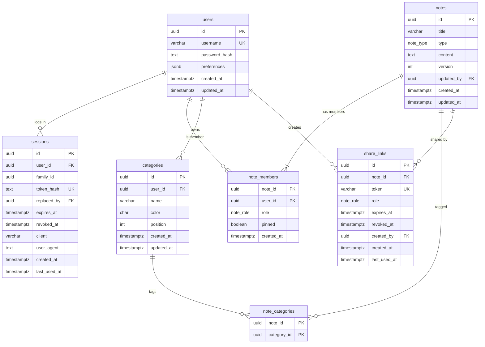

# Data model

PostgreSQL 17, managed with Prisma migrations (`backend/prisma/`). All IDs are UUIDs and all timestamps are `timestamptz` in UTC.



## Enums

| Enum | Values |
|------|--------|
| `note_type` | `text`, `list` |
| `note_role` | `owner`, `editor`, `viewer` (`share_links.role` may only be `editor` or `viewer`, enforced by a CHECK) |

## Tables

### `users`

| Column | Type | Notes |
|--------|------|-------|
| `id` | uuid PK | |
| `username` | varchar(32), unique | Stored lowercase (AUTH-2). Raw SQL CHECK `users_username_format`: `^[a-z0-9][a-z0-9._-]{2,31}$` (AUTH-1). Accounts created before usernames got one from their former email (migration `20261121120000_usernames`). |
| `password_hash` | text | argon2id |
| `preferences` | jsonb, default `{}` | UI preferences that follow the user across devices (see below) |
| `created_at`, `updated_at` | timestamptz | |

Shape of `preferences` (validated by the API, unknown keys rejected):

```json
{
  "theme": "blushNoir",
  "noteSort": "favorites"
}
```

`theme` is a theme id (THEME-2). `noteSort` is the order of the notes grid: `favorites` (default), `updated`, `title` or `category` (NOTE-9). An unknown id, such as an old `"system"`, shows the default theme. Keys saved by older versions (`lightTheme`, `darkTheme`, `checkedItemsToBottom`) are ignored and left out of API responses.

### Encrypted content (locked notes, NOTE-17)

The content of a locked note is a JSON envelope written by the app:

```json
{ "v": 1, "kdf": "PBKDF2-SHA256", "iter": 600000, "salt": "<base64, 16 bytes>", "iv": "<base64, 12 bytes>", "data": "<base64: AES-256-GCM ciphertext + 16-byte tag>" }
```

The key is derived from the note's password and `salt` with PBKDF2-SHA256 (`iter` iterations) in the browser (`frontend/src/features/notes/noteCrypto.ts`); a new `iv` is drawn for every save, a new `salt` for every new password. The server checks the envelope's shape only (`backend/src/lib/encrypted-content.ts`) and never sees the password or the text.

### `sessions`

One row per refresh token. A login creates a new **family**, and each refresh adds a row to that family and fills `replaced_by` on the previous one.

| Column | Type | Notes |
|--------|------|-------|
| `id` | uuid PK | |
| `user_id` | uuid FK → users, cascade | |
| `family_id` | uuid | Shared by all refresh tokens that come from the same login |
| `token_hash` | text, unique | SHA-256 of the refresh token (the token itself is never stored) |
| `replaced_by` | uuid FK → sessions, nullable | Set when the token is used. If a token that was already replaced is used again, every session in its family is revoked. Exception: the replacement was created less than 2 minutes ago and has never been used (a lost response, see [architecture.md §3](architecture.md#3-authentication)). |
| `expires_at` | timestamptz | `now() + REFRESH_TOKEN_TTL` when the row is created. Because each refresh creates a new row, the session's expiry slides forward with use. |
| `revoked_at` | timestamptz, nullable | Set by logout, a password change, or reuse detection |
| `client` | varchar(16), nullable | `web` or `android`, for information |
| `user_agent` | text, nullable | |
| `created_at`, `last_used_at` | timestamptz | |

### `notes`

| Column | Type | Notes |
|--------|------|-------|
| `id` | uuid PK | |
| `title` | varchar(200), default `''` | |
| `type` | `note_type` | |
| `locked` | boolean, default `false` | NOTE-17: `content` is then an encrypted envelope (below) and nothing is derived from it (no preview, progress or search). |
| `content` | text, default `''` | Markdown (GFM). Max 1 MB, checked by the API. |
| `sort_title` | text, ICU collation `und-x-icu`, **generated** | `NULLIF(btrim(title), '')`, written by PostgreSQL only (raw SQL, migration `20261122000000_note_sort_title`). Used by `GET /notes?sort=title` so that accents and case sort naturally and untitled notes come last (NOTE-9). |
| `version` | int, default 1 | Increased on every content update, used for 409 conflict detection (NOTE-13) |
| `updated_by` | uuid FK → users, nullable, `ON DELETE SET NULL` | NULL when the last edit came through a share link |
| `created_at`, `updated_at` | timestamptz | |

Indexes: GIN trigram indexes (`pg_trgm`) on `title` and `content` for case-insensitive search (NOTE-10).

### `note_members`

Who can access a note, with which role, plus per-user state for that note.

| Column | Type | Notes |
|--------|------|-------|
| `note_id` | uuid FK → notes, cascade | PK part 1 |
| `user_id` | uuid FK → users, cascade | PK part 2 |
| `role` | `note_role` | |
| `pinned` | boolean, default false | Per user (NOTE-11) |
| `created_at` | timestamptz | |

Constraints:
- **Exactly one owner per note**: a partial unique index `UNIQUE (note_id) WHERE role = 'owner'`. Prisma cannot express this, so it is written in raw SQL in the migration. The note and its owner row are always created in the same transaction.
- Index on `(user_id, role)` for the **My notes** and **Shared with me** lists.

### `categories`

| Column | Type | Notes |
|--------|------|-------|
| `id` | uuid PK | |
| `user_id` | uuid FK → users, cascade | Categories are personal (CAT-4) |
| `name` | varchar(40) | Unique per user, case-insensitive: `UNIQUE (user_id, lower(name))` |
| `color` | char(7) | `CHECK (color ~ '^#[0-9A-Fa-f]{6}$')` |
| `position` | int, default 0 | Display order |
| `created_at`, `updated_at` | timestamptz | |

### `note_categories`

| Column | Type | Notes |
|--------|------|-------|
| `note_id` | uuid FK → notes, cascade | PK part 1 |
| `category_id` | uuid FK → categories, cascade | PK part 2 |

Application rules:
- Only categories owned by the caller can be added, and only to notes the caller is a member of.
- When a member leaves or is removed from a note, their `note_categories` rows for that note are deleted in the same transaction.
- Reads always filter on `categories.user_id = caller`, so nobody sees another member's tags.

### `share_links`

| Column | Type | Notes |
|--------|------|-------|
| `id` | uuid PK | |
| `note_id` | uuid FK → notes, cascade | |
| `token` | varchar(64), unique | 32 random bytes, base64url-encoded (43 characters) |
| `role` | `note_role` | `CHECK (role IN ('editor','viewer'))` |
| `expires_at` | timestamptz, nullable | NULL means no expiry |
| `revoked_at` | timestamptz, nullable | |
| `created_by` | uuid FK → users | |
| `created_at`, `last_used_at` | timestamptz | |

The token is stored **in plain text** so the owner can copy the link again later (SHARE-9). Hashing it would not protect much: anyone who can read the database can already read the note it gives access to. The token must never appear in logs. The request logger redacts `/s/*` and `/api/v1/shared/*` paths.

## Typical queries

| Need | Query |
|------|-------|
| My notes | `note_members` where `user_id = me AND role = 'owner'`, joined with `notes`. Sorted by `pinned DESC, updated_at DESC`. |
| Shared with me | Same, with `role IN ('editor','viewer')` |
| Role of the caller on a note | `SELECT role FROM note_members WHERE note_id = $1 AND user_id = $2` |
| My categories on a set of notes | `note_categories` joined with `categories`, where `categories.user_id = me` |
| Resolve a share link | `share_links` where `token = $1 AND revoked_at IS NULL AND (expires_at IS NULL OR expires_at > now())` |
