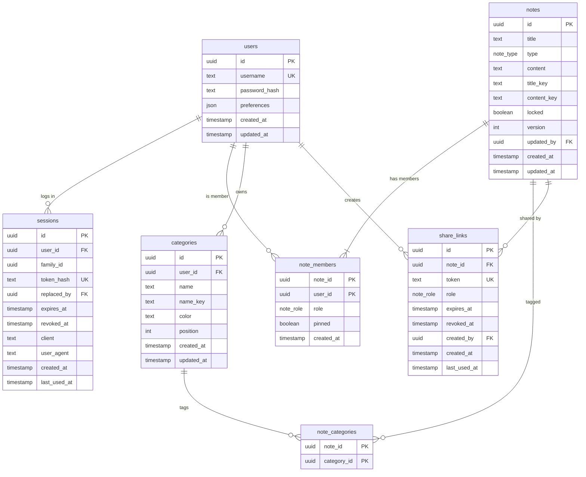

# Data model

SQLite, in one file (`prod.db`, see [deployment.md](deployment.md)), managed with Prisma migrations (`backend/prisma/`). The API opens it in WAL mode (`journal_mode = WAL`): readers never wait for the writer.

Storage conventions (SQLite has few column types; Prisma maps them):

| In this document | Stored as |
|------------------|-----------|
| uuid | TEXT, generated by the API |
| text | TEXT. Length limits are checked by the API (zod schemas), not by SQLite. |
| boolean | 0 or 1 |
| timestamp | UTC, in milliseconds since 1970 (Prisma's DateTime) |
| json | TEXT holding JSON |
| enum | TEXT, values checked by CHECK constraints |



## Enums

Stored as text and checked by CHECK constraints (`notes_type`, `note_members_role`, `share_links_role_not_owner`).

| Enum | Values |
|------|--------|
| `note_type` | `text`, `list` |
| `note_role` | `owner`, `editor`, `viewer` (`share_links.role` may only be `editor` or `viewer`) |

Roles sort alphabetically in SQL, so the API sorts members by rank itself (owner, editor, viewer: `byRoleDesc` in `access.ts`).

## Folded keys

SQLite only ignores case for ASCII letters (`LIKE`, `NOCASE`) and has no locale-aware collation. So the API stores **keys** next to the text, computed in `backend/src/lib/fold.ts` on every write:

| Column | Value | Used for |
|--------|-------|----------|
| `notes.title_key` | title in lower case, without accents (`Été` → `ete`); NULL when the title is blank | search (NOTE-10) and the A to Z order: "À faire", "apple", "Été", "Zèbre", untitled notes last (NOTE-9) |
| `notes.content_key` | the same for the content; empty while the note is locked | search (NOTE-10, NOTE-17) |
| `categories.name_key` | name in lower case (accents kept) | one category name per user regardless of case (CAT-1) |

In `title_key` and `content_key`, `%` and `_` are replaced by private-use characters, because Prisma does not escape these `LIKE` wildcards: a search for `100%` finds "100%" only. Keys are never sent to clients.

## Tables

### `users`

| Column | Type | Notes |
|--------|------|-------|
| `id` | uuid PK | |
| `username` | text, unique | Stored lowercase (AUTH-2). CHECK `users_username_format`: 3 to 32 characters among `a-z 0-9 . _ -`, starting with a letter or a digit (AUTH-1). |
| `password_hash` | text | argon2id |
| `preferences` | json, default `{}` | UI preferences that follow the user across devices (see below) |
| `created_at`, `updated_at` | timestamp | |

Shape of `preferences` (validated by the API, unknown keys rejected):

```json
{
  "theme": "blushNoir",
  "noteSort": "favorites"
}
```

`theme` is a theme id (THEME-2). `noteSort` is the order of the notes grid: `favorites` (default), `updated`, `title` or `category` (NOTE-9). An unknown id, such as an old `"system"`, shows the default theme. Keys saved by older versions (`lightTheme`, `darkTheme`, `checkedItemsToBottom`) are ignored and left out of API responses.

### Encrypted content (locked notes, NOTE-17)

The content of a locked note is a JSON envelope written by the app:

```json
{ "v": 1, "kdf": "PBKDF2-SHA256", "iter": 600000, "salt": "<base64, 16 bytes>", "iv": "<base64, 12 bytes>", "data": "<base64: AES-256-GCM ciphertext + 16-byte tag>" }
```

The key is derived from the note's password and `salt` with PBKDF2-SHA256 (`iter` iterations) in the browser (`frontend/src/features/notes/noteCrypto.ts`); a new `iv` is drawn for every save, a new `salt` for every new password. The server checks the envelope's shape only (`backend/src/lib/encrypted-content.ts`) and never sees the password or the text.

### `sessions`

One row per refresh token. A login creates a new **family**, and each refresh adds a row to that family and fills `replaced_by` on the previous one.

| Column | Type | Notes |
|--------|------|-------|
| `id` | uuid PK | |
| `user_id` | uuid FK → users, cascade | |
| `family_id` | uuid | Shared by all refresh tokens that come from the same login |
| `token_hash` | text, unique | SHA-256 of the refresh token (the token itself is never stored) |
| `replaced_by` | uuid FK → sessions, nullable | Set when the token is used. If a token that was already replaced is used again, every session in its family is revoked. Exception: the replacement was created less than 2 minutes ago and has never been used (a lost response, see [architecture.md §3](architecture.md#3-authentication)). |
| `expires_at` | timestamp | `now() + REFRESH_TOKEN_TTL` when the row is created. Because each refresh creates a new row, the session's expiry slides forward with use. |
| `revoked_at` | timestamp, nullable | Set by logout, a password change, or reuse detection |
| `client` | text, nullable | `web` or `android`, for information |
| `user_agent` | text, nullable | |
| `created_at`, `last_used_at` | timestamp | |

### `notes`

| Column | Type | Notes |
|--------|------|-------|
| `id` | uuid PK | |
| `title` | text, default `''` | Max 200 characters (API) |
| `type` | `note_type` | |
| `locked` | boolean, default `false` | NOTE-17: `content` is then an encrypted envelope (above) and nothing is derived from it (no preview, progress or search). |
| `content` | text, default `''` | Markdown (GFM). Max 1 MB, checked by the API. |
| `title_key`, `content_key` | text | [Folded keys](#folded-keys), written by the API only |
| `version` | int, default 1 | Increased on every content update, used for 409 conflict detection (NOTE-13) |
| `updated_by` | uuid FK → users, nullable, `ON DELETE SET NULL` | NULL when the last edit came through a share link |
| `created_at`, `updated_at` | timestamp | |

### `note_members`

Who can access a note, with which role, plus per-user state for that note.

| Column | Type | Notes |
|--------|------|-------|
| `note_id` | uuid FK → notes, cascade | PK part 1 |
| `user_id` | uuid FK → users, cascade | PK part 2 |
| `role` | `note_role` | |
| `pinned` | boolean, default false | Per user (NOTE-11) |
| `created_at` | timestamp | |

Constraints:
- **Exactly one owner per note**: a partial unique index `note_members_one_owner`, `UNIQUE (note_id) WHERE role = 'owner'`. Prisma cannot express this, so it is written in raw SQL in the migration. The note and its owner row are always created in the same transaction.
- Index on `(user_id, role)` for the **My notes** and **Shared with me** lists.

### `categories`

| Column | Type | Notes |
|--------|------|-------|
| `id` | uuid PK | |
| `user_id` | uuid FK → users, cascade | Categories are personal (CAT-4) |
| `name` | text | 1 to 40 characters (API) |
| `name_key` | text | [Folded key](#folded-keys). `UNIQUE (user_id, name_key)`: names are unique per user, case-insensitive. |
| `color` | text | CHECK `categories_color_hex`: `#` and 6 hex digits |
| `position` | int, default 0 | Display order |
| `created_at`, `updated_at` | timestamp | |

### `note_categories`

| Column | Type | Notes |
|--------|------|-------|
| `note_id` | uuid FK → notes, cascade | PK part 1 |
| `category_id` | uuid FK → categories, cascade | PK part 2 |

Application rules:
- Only categories owned by the caller can be added, and only to notes the caller is a member of.
- When a member leaves or is removed from a note, their `note_categories` rows for that note are deleted in the same transaction.
- Reads always filter on `categories.user_id = caller`, so nobody sees another member's tags.

### `share_links`

| Column | Type | Notes |
|--------|------|-------|
| `id` | uuid PK | |
| `note_id` | uuid FK → notes, cascade | |
| `token` | text, unique | 32 random bytes, base64url-encoded (43 characters) |
| `role` | `note_role` | CHECK `share_links_role_not_owner`: `editor` or `viewer` |
| `expires_at` | timestamp, nullable | NULL means no expiry |
| `revoked_at` | timestamp, nullable | |
| `created_by` | uuid FK → users | |
| `created_at`, `last_used_at` | timestamp | |

The token is stored **in plain text** so the owner can copy the link again later (SHARE-9). Hashing it would not protect much: anyone who can read the database can already read the note it gives access to. The token must never appear in logs. The request logger redacts `/s/*` and `/api/v1/shared/*` paths.

## Raw SQL objects and future migrations

The CHECK constraints and `note_members_one_owner` exist only in the SQL of the migration `20261123000000_init`. To change a table, a SQLite migration rebuilds it (Prisma's "RedefineTables": new table, copy, drop, rename), which loses them. When generating a migration with `prisma migrate dev --create-only`, add them back to the rebuilt table before applying it. The header of `schema.prisma` lists them.

## Typical queries

| Need | Query |
|------|-------|
| My notes | `note_members` where `user_id = me AND role = 'owner'`, joined with `notes`. Sorted by `pinned DESC, updated_at DESC`. |
| Shared with me | Same, with `role IN ('editor','viewer')` |
| Search | `title_key LIKE '%q%' OR (locked = 0 AND content_key LIKE '%q%')`, with `q` folded the same way |
| Role of the caller on a note | `SELECT role FROM note_members WHERE note_id = ? AND user_id = ?` |
| My categories on a set of notes | `note_categories` joined with `categories`, where `categories.user_id = me` |
| Resolve a share link | `share_links` where `token = ? AND revoked_at IS NULL AND (expires_at IS NULL OR expires_at > now)` |
